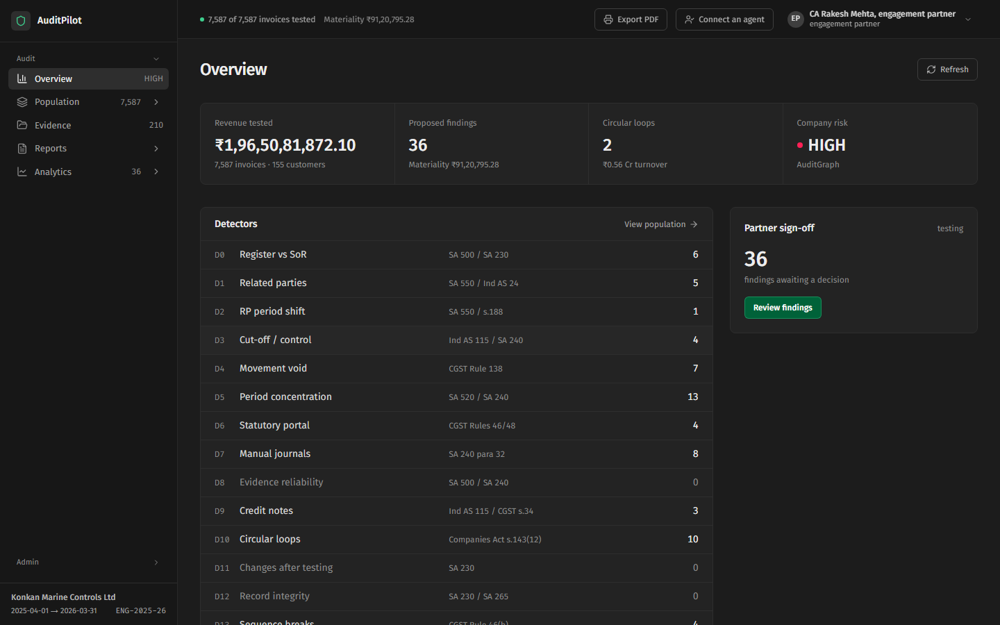

# AuditPilot AI: audit every invoice, not a sample

An AI-run statutory revenue audit, built for **ELEVATE 1.0 (DJSCE), Problem Statement 04**. AuditPilot runs a mini
ERP with a tamper-evident ledger and mock GST portals, and an audit engine that tests **100% of the books** against
the register the client uploads. Everything is also exposed as an **MCP server**, so any AI agent holding a token can
work in the audit with exactly that token's permissions. Detectors decide what is flagged; people sign off.

- **Live app:** https://audit-pilot-rosy.vercel.app
- **API + MCP:** https://auditpilot-api-ooy6.onrender.com (`/api/health`, `/mcp`). It runs on Render's free plan, so
  the first request after a quiet spell takes about a minute.



## What it does

| | |
|---|---|
| **100% testing** | 16 detector families (D0 to D15) run on every invoice: register vs books, related parties, cut-off, e-way bills and GST returns, period-end concentration, manual journals, credit notes, circular trading, sequence breaks, purchase-to-pay, and injection attempts hidden in client data |
| **Circular trading** | Round trips in goods and cash, drawn as a ring with the value, the parties and the invoices behind them |
| **Explainable risk** | Every invoice's risk score splits exactly into the hits that drove it (Shapley values); Benford's-law and period-end spike charts |
| **Findings and memo** | Findings mapped to SA 240, SA 500, SA 550, Ind AS 115 and CGST rules, with proposed adjusting entries (Dr = Cr, in integer paise) and a draft statutory audit memo (PDF / Markdown) |
| **Client portal** | The client uploads the sales register and related-party list (stored byte for byte, server SHA-256), enters records, and answers evidence requests |
| **Accounts** | E-mail sign-up and sign-in (Supabase), organisations, invites by role; roles come from the organisation, never from the user's profile |
| **AI agents (MCP)** | 53 tools behind one gateway. Claude, ChatGPT, Cursor, VS Code, Gemini CLI, n8n or your own code connect with a token; the **Connect an agent** page gives the exact steps |
| **In-app assistant** | Answers from live data with the user's own permissions; it proposes changes and runs them only when the user clicks Run |
| **Controls** | Auditors cannot write business data; every action, including refused ones, is on a hash-chained audit trail; only the engagement partner confirms findings and signs off, in the web app |

Measured on our synthetic test company (FY 2025-26, 7,000 invoices with planted irregularities): **36 of 36** planted
irregularities caught, 100% precision on serious hits ([`docs/FEASIBILITY.md`](docs/FEASIBILITY.md)). This is a
prototype on synthetic data, not a tool validated on real engagements.

## How it is built

```text
 Next.js web app (web/) ──REST──► FastAPI API (app/api_server.py) ─┐
 Claude / ChatGPT / Cursor ─MCP─► MCP gateway (app/gateway.py) ─────┼─► ERP + audit engine ─► SQLite (per organisation)
 In-app assistant ──────────MCP─┘   token -> role -> allowed tools  │   (app/*.py)              erp / audit / ext / pbc
                                     every call -> audit trail      └─► Supabase (sign-in only)
```

- **Backend:** Python 3.11, FastAPI, the MCP Python SDK (`mcp>=2.3`), SQLite (one set of databases per organisation),
  the OpenAI Agents SDK (assistant, investigator) and LangGraph (CSV check). Money is integer paise; no floats on client data.
- **Frontend:** Next.js 16, React 19, Tailwind CSS 4, lucide icons.
- **Hosting:** Render (Docker, API and MCP on one port, demo data baked into the image) and Vercel (`web/`).

## Run it locally

```bash
pip install -r requirements.txt
python -m app.seed --reset --invoices 7000        # demo company + identities.json (one token per role)
python -m app.demo_audit                           # optional warm-up audit run
python -m app.mcp_server                           # MCP on :8000
python -m uvicorn app.api_server:app --port 8001   # REST API on :8001

cd web && npm install && npm run dev               # web app on :3000 (NEXT_PUBLIC_API_URL defaults to :8001)
```

Production runs the API and MCP server in one process instead: `python -m uvicorn app.serve:app --port 10000`.

Optional settings go in `.env` (see [`.env.example`](.env.example)): `OPENAI_API_KEY` turns on the assistant and the
AI investigator; `SUPABASE_URL` and `SUPABASE_ANON_KEY` turn on e-mail sign-up.

## Try it

- **Demo company:** on the sign-in page choose **Sign in with an access token** and paste a token from
  `identities.json` (`aud_` auditor, `adm_` client CFO, `ptn_` engagement partner, …). With `DEMO_ROLE_SWITCHER=1`
  the page lists demo personas to click.
- **Your own organisation:** sign up, create the organisation (you become its partner), invite the client, and follow
  [`docs/test-data/README.md`](docs/test-data/README.md) with the sample register and related-party files.
- **Connect an AI agent:** click **Connect an agent** in the app, or see [`docs/MCP_GUIDE.md`](docs/MCP_GUIDE.md).
  For example, with Claude Code:

  ```bash
  claude mcp add --transport http auditpilot http://localhost:8000/mcp --header "Authorization: Bearer aud_..."
  ```

## Tests

```bash
python -m pytest -q          # ~170 tests
python -m app.selftest       # end-to-end check (23 steps)
python scripts/mcp_check.py  # MCP smoke test, as an agent would connect
```

## Deploy

Render (backend, from [`render.yaml`](render.yaml)) and Vercel (web app, root directory `web`). Click-by-click steps:
[`DEPLOY.md`](DEPLOY.md).

## Repository map

| Path | What |
|---|---|
| `app/` | ERP services, audit engine and detectors, MCP gateway and tools, REST API, accounts and organisations |
| `web/` | The Next.js web app that is deployed (`web_v2/` is the same source, used for development) |
| `schema/` | SQLite schemas |
| `tests/` | pytest suite |
| `vault/` | Specs and decisions: start at [`vault/README.md`](vault/README.md) |
| `docs/` | Feasibility numbers, MCP guide, test data |
| `scripts/` | Start scripts and the MCP smoke test |

More: [`HOW_IT_WORKS.md`](HOW_IT_WORKS.md) · [`AGENTS.md`](AGENTS.md) (rules for coding agents) · [`WHO_DOES_WHAT.md`](WHO_DOES_WHAT.md)

## Team

Shriyans, Ibrahim, Darshan, Aarav. Built at ELEVATE 1.0, DJ Sanghvi College of Engineering.

Questions or feedback? Open an issue on this repository.