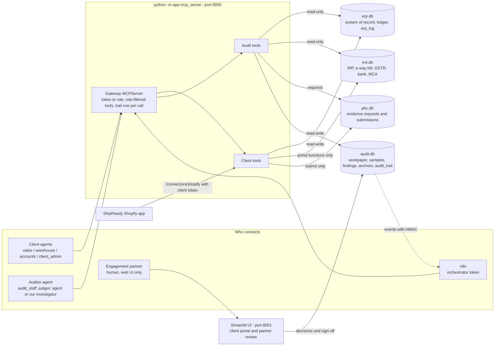

# 02 · System architecture: AuditPilot AI

> Revised by Claude, 2026-10-10. Replaces the first draft (one DB, an event bus, `update_invoice`, a self-asserted role). Tool names are from `04`, which is the only catalogue. Tables are in `03`.

**In one line:** a mini ERP of a fictional manufacturer, posting to a tamper-evident double-entry ledger and to mock government portals; an audit engine that tests **100%** of it against the register the client uploads; all of it exposed over MCP so that **any** agent holding a token can run the business or audit it, with exactly that token's permissions; and a human partner who confirms every conclusion.

## 1. Components

| Component | Owner | Notes |
|---|---|---|
| Gateway + tools (`mcp_server.py`, `tools_*.py`) | Shriyans | streamable HTTP + stdio, `04 §2` |
| ERP services (`erp.py`) | Shriyans | every write → `erp_log`; postings via `ledger.py` |
| Ledger, chains, portal, trail (`ledger.py`, `chain.py`, `portal.py`, `trail.py`) | Ibrahim | `03 §6` |
| Intake, register, related parties, workpaper | Darshan | `05 D0–D2`, `06` |
| Analytics, sampling, findings, memo, investigator | Aarav | `05`, `06`, `10` |
| Evidence + change detection + integrity (`evidence.py`) | Ibrahim | `05 D8, D11, D12` |
| UI (`ui/app.py`) | Antigravity → Shriyans | Streamlit |

## 2. What proves a sale happened (the PS's "deciding what must exist")

| Stage of a sale | Records | What it proves | Where it's tested |
|---|---|---|---|
| First customer interaction | `sales_orders` in ENQUIRY (enquired_on, channel, contact) | a real counterparty asked, when, and from which phone/email | D1 (contact vs director identifiers), D5 new-customer-at-year-end |
| Commitment and pricing | `sales_orders` (quoted/confirmed, delivery_terms, credit_days) + `so_lines` + `items.list_rate` + `schemes` | agreed qty, price, terms; abnormal RP prices | D2 price test, D5 discount spike, D3 (terms decide control) |
| Physical movement | `movements` (+lines; LR, vehicle, POD) + `invoice_movements` + ext `ewaybills` | goods left, how many, when control passed | D3, D4, D6, D8 |
| Revenue and tax recognition | `invoices` + `invoice_lines` + `journals` + ext `einvoices` / `gstr1_docs` / `gstr3b` | what was billed, booked and reported to the government | D0, D6, D7, D13 |
| Cash settlement | `settlements` + ext `bank_txns` (payer account) | who actually paid, from which account | D4 unpaid/third-party/RP payer, D10 |
| Promotions and reversals | `schemes`, line discounts, `credit_notes` + `cn_lines` + IN `movements` | discounts and rebates, and whether goods came back | D5, D9 |

## 3. End-to-end flow (core + beyond the core)

1. **Client upload.** `upload_sales_register` and `upload_related_parties` (MCP), or the client portal page. The file goes into `pbc.submissions` with a server-computed SHA-256.
2. **"The system is notified."** `intake.on_client_upload` runs in-process as the system principal. It freezes the rows verbatim into `audit.register_rows` / `rp_list_rows`, creates or refreshes the engagement, writes an `events` row (`REGISTER_UPLOADED`) and an `anchors` row, and `notify.emit` pings n8n (W1).
3. **Workpaper Sheet 1.** The register is pasted exactly as provided, plus auditor columns: SoR match and RP status by the SoR customer and control date.
4. **D0** `reconcile_register_to_system`: every register ↔ SoR difference is a hit.
5. **100% analytics** `run_analytics`: D1–D7, D9, D10, D13, D14 → `risk_hits`.
6. **Sampling** `select_samples(sales_tod | cutoff | credit_note)`. Analytics hits feed the KEY stratum; the seed is recorded. **The first call starts testing**: `testing_started_seq` + anchor + per-sample bundle snapshots.
7. **"Samples are sent to the client automatically."** The same call writes `pbc.evidence_requests` (no reasons). The client sees them via `list_evidence_requests`, and n8n W2 emails and reminds.
8. **Client evidence.** `render_document` / `upload_evidence`: the server hashes, stores and extracts.
9. **Testing** `test_sample`: D8 + the Fig. 2 attributes (amount, party, sales GL, period, tax). Then `check_for_changes` (D11) and `verify_integrity` (D12) at every test, at deliverables and at review.
10. **Findings.** `findings.from_hits` and `propose_finding` produce PROPOSED findings with plain-language reasons, ₹ impact and AJEs. Our GPT investigator (optional) adds notes the same way any MCP client would.
11. **Deliverables** `generate_deliverables`: the 4-sheet xlsx, memo and trail export, marked DRAFT. Then `submit_for_partner_review`.
12. **Human partner** (UI only): confirm / reject / modify each finding → sign off → final deliverables + SIGNOFF anchor → the engagement locks.

## 4. Independence: five layers, each of which holds alone

1. **Credential identity.** The role comes from a token (`identities.json`), never from a tool argument or header (`04 §1`).
2. **Role-filtered tools.** An audit identity never even *sees* a client tool (`Gateway.list_tools`), and `call_tool` re-checks.
3. **Storage.** Audit roles open `erp.db`/`ext.db` with `mode=ro` + `query_only`, so even a buggy auditor tool cannot write business data. Client roles have no `audit.db` handle at all.
4. **AJEs are proposals** in audit.db. Only management posts them (`post_journal_entry(aje_ref)`).
5. **Human-only conclusions.** The partner token is rejected on MCP, and confirm/sign-off exist only in the UI.

Every call, including every denial, is a row in the hash-chained `audit_trail`.

## 5. Tamper evidence (what "cannot be silently altered" means here)

- `erp_log`: a hash-chained edit log of every create/amend/cancel/post (before + after images). Journals are append-only with Dr = Cr per voucher.
- `audit_trail`: a hash-chained log of every agent/tool action. **Each row stores the erp_log head** (an anchor), and `anchors` rows add explicit checkpoints (upload, testing start, each test, deliverables, sign-off).
- `verify_integrity` recomputes both chains, checks every anchor, compares current rows with their latest logged image (catching direct SQLite edits), and checks Dr = Cr. A rewritten chain fails at the first anchor after the rewrite.
- Triggers block UPDATE/DELETE as a guard against bugs. **We don't claim triggers or a hash chain alone make the file tamper-proof.** The claim is that tampering is *detected*, because the auditor's anchors sit in a file the client can't open.

## 6. Change after testing → affected samples

See `05 D11`. In short: changes are a query over `erp_log` (seq > the sample's `snapshot_seq` touching its bundle), plus out-of-band edit detection, plus re-uploads. Each change reports `{table, pk, field: [old, new], by, role, tool, at}` and the list of affected samples. Stale is computed, never stored.

## 7. Where sponsors and AI plug in (`10`)

- **n8n:** event webhooks out; the MCP Client node in, with the orchestrator token (W1–W4).
- **ShipReady:** a Shopify connector feeding SO/discount/fulfilment/refund events through client tokens.
- **Voroa:** an adapter slot (external confirmations, evidence chasing).
- **GPT:** the investigator is an MCP client with an audit_staff token; optional extraction. The core runs with `LLM_ENABLED=0` (**on-prem mode**: SQLite + stdio + Streamlit, no cloud).
